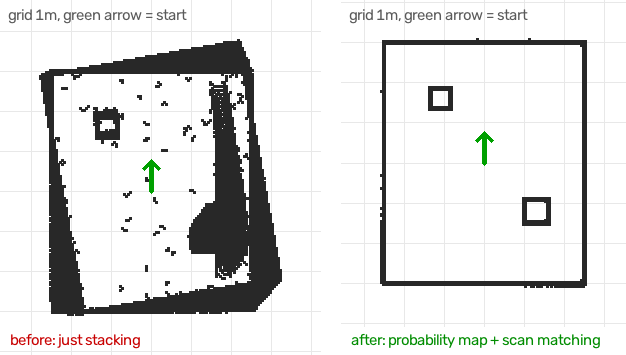

# go2-pro-dashboard

Unitree **Go2 Pro**에서 PC로 **센서 · 카메라 · LiDAR** 데이터를 무선(Wi-Fi / WebRTC)으로 받아 웹 대시보드에 실시간으로 보여주는 프로젝트입니다. 연구실 인턴 과제로 만들었습니다.

- 왼쪽: 전면 카메라 영상 (같은 PC 약 14fps, 공개 주소 약 8fps) + LiDAR를 위에서 본 지도 (로봇 중심, 반경 4m, 지나온 경로 표시)
- 오른쪽: 배터리, 위치, 방향(yaw), 속도, 자세(roll/pitch), 장애물 거리(LiDAR로 계산), 관절 모터 온도 12개
- 경고 띠: 배터리 20% 이하, 모터 60°C 이상(70°C 이상은 위험), 연결 끊김
- 📷 사진 저장, ⏺ 녹화(영상 mp4 + 센서 CSV), 녹화 파일 내려받기
- 연결 단계(연결 중 / 실패 / 재연결 / 서버 꺼짐)를 화면에 표시하고, 끊기면 자동 재연결
- 로봇에서 값이 안 들어오는 항목(Go2 Pro의 발 접촉력 등)은 자동으로 숨김
- **데모 모드**: 로봇 없이 가짜 데이터로 화면을 개발·확인 (`--demo`)

Go2 Air/Pro는 공식 SDK가 열려 있지 않아서, 앱과 같은 WebRTC 방식을 쓰는 커뮤니티 라이브러리 [`unitree_webrtc_connect`](https://github.com/legion1581/unitree_webrtc_connect) (MIT)를 사용합니다.

## 파일

| 파일 | 내용 |
|---|---|
| `dashboard.py` | 웹 대시보드 서버 (Flask). 로봇 연결 1개로 영상·센서·LiDAR를 받아 중계 |
| `web/index.html` | 대시보드 화면 |
| `sensors.py` | 터미널에 센서값 출력 + `logs/`에 CSV 저장 |
| `camera.py` | OpenCV 창으로 카메라 보기, 사진(`s`)·녹화(`r`) → `captures/` |
| `대시보드_켜기끄기.bat` | **더블클릭할 때마다 켜기/끄기** (창 없이 실행 + 공개 주소 + 브라우저, 다시 누르면 종료) |
| `대시보드_실행.bat` | 더블클릭으로 대시보드 실행 (창이 보이는 방식) |
| `공개주소_실행.bat` | 대시보드 + 공개 주소(Tailscale 고정 / 없으면 Cloudflare 임시)를 한 번에 실행 |
| `web/demo.js`, `web/config.js` | 고정 주소용 브라우저 데모와 설정 |
| `데모_실행.bat` | 로봇 없이 데모 모드로 실행 |
| `ros2/` | WSL ROS2 SLAM 설치·실행·지도 저장 스크립트 |

## 설치

Windows, Python 3.12 기준입니다.

```bash
py -3.12 -m venv .venv
.venv\Scripts\python -m pip install -r requirements.txt
copy .env.example .env
```

`.env`에 로봇 IP와 AES 키를 채웁니다.

```
UNITREE_ROBOT_IP=<로봇 IP, Unitree Go 앱 네트워크 화면의 wlan0>
UNITREE_AES_128_KEY=<32자리 16진수>
```

## 실행

로봇은 WebRTC 연결을 **한 번에 하나만** 받습니다. 폰 앱과 다른 스크립트는 꺼 두고 하나만 실행하세요.

```bash
.venv\Scripts\python dashboard.py --demo   # 로봇·Wi-Fi 없이 가짜 데이터 (.env 필요 없음)
.venv\Scripts\python dashboard.py      # 브라우저가 http://127.0.0.1:8000 으로 열림
.venv\Scripts\python sensors.py        # 터미널 출력 + CSV
.venv\Scripts\python camera.py         # 카메라 창
```

## 외부에서 보기 — 고정 주소

**https://uyeonim.github.io/go2-pro-dashboard/** (GitHub Pages, 항상 열림)

- 노트북 대시보드가 켜져 있으면 → **실제 화면**으로 이동
- 꺼져 있으면 → 그 자리에서 **브라우저 데모** (카메라·LiDAR는 실제 로봇으로 미리 녹화한 영상 `web/demo_cam.mp4`·`web/demo_lidar.mp4`, 센서 값은 예시, 화면에 DEMO 표시)

### 노트북 쪽 설정 (처음 한 번, Tailscale Funnel)

1. https://tailscale.com 에 가입하고 Windows용 Tailscale을 설치·로그인
2. `공개주소_실행.bat` 실행 → 처음에는 Funnel 허용 안내 링크가 나오니 열어서 허용
3. 나온 `https://노트북이름.xxxx.ts.net` 주소를 [web/config.js](web/config.js)의 `GO2_LIVE_URL`에 넣고 push
4. 이후에는 **`대시보드_켜기끄기.bat`**(바탕화면 바로가기로 만들어 두면 편해요)을 더블클릭하면 켜지고, 다시 누르면 꺼집니다. 켜져 있는 동안만 고정 주소가 실제 화면으로 이어지고, 꺼져 있으면 데모로 열립니다. 로그는 `logs/dashboard_out.log`, `logs/dashboard_err.log`.

Tailscale이 없으면 `공개주소_실행.bat`이 예전처럼 Cloudflare 임시 주소(`https://xxxx.trycloudflare.com`, 실행할 때마다 바뀜)를 엽니다.

- 기본은 **잠금 없음**: 링크를 아는 사람은 실제 화면(연구실 카메라)을 보고, 녹화를 시작하고, 파일을 내려받을 수 있습니다. 링크는 필요한 사람에게만 공유하세요.
- (선택) 잠그고 싶으면 `.env`에 `DASHBOARD_PASSWORD=...`를 넣으면 실제 화면에 로그인이 생깁니다. 데모는 항상 잠금 없이 열립니다.

## 지도 만들기 (ROS2 SLAM)

WSL Ubuntu 24.04 + ROS2 Jazzy에서 [`go2_ros2_sdk`](https://github.com/abizovnuralem/go2_ros2_sdk)와 `slam_toolbox`로 방 전체 지도를 만듭니다.

```bash
wsl -d Ubuntu-24.04
bash /mnt/c/Users/yeonwoo/robotdog/ros2/setup_wsl.sh      # 최초 1회 설치 (sudo 비밀번호 필요, 로봇 없어도 됨)
bash /mnt/c/Users/yeonwoo/robotdog/ros2/run_slam.sh       # 로봇 연결 + SLAM + RViz (.env의 IP·키 사용)
bash /mnt/c/Users/yeonwoo/robotdog/ros2/save_map.sh lab   # 다른 WSL 창에서: maps/lab.png/.pgm/.yaml 저장
bash /mnt/c/Users/yeonwoo/robotdog/ros2/run_detector.sh   # 다른 WSL 창에서: 카메라 사물 인식 (GPU)
```

- 사물 인식은 PyTorch(GPU, 약 3GB)를 씁니다. 지도만 필요하면 `SKIP_TORCH=1 bash .../setup_wsl.sh`로 건너뛸 수 있습니다.

## 대시보드에서 자율 이동 (추천)

대시보드를 **이 노트북에서(`http://127.0.0.1:8000`)** 열면 LiDAR 지도 위에 버튼이 생깁니다.

- **👂 단어 듣기**: 켜 두면 계속 듣다가 "인사·하트·엎드려·일어나·멈춰"만 알아듣고 바로 동작 (Claude 안 씀, 다른 말은 무시, 3초에 한 번, 이동 중엔 동작 안 함). 🔊 읽어주기는 Claude 답을 소리로 읽는 것.
- **말로 시키기** (3번 과제, `agent.py`): 오른쪽 칸에 글이나 🎤(크롬 음성 인식)로 말하면 Claude(`claude-opus-5-5`, effort low)가
  도구를 골라 실행합니다 — 상태 확인, 장소 저장·이동(로봇 내장 내비게이션), 조금 이동, 동작(하트·인사·앉기 등, 점프·뒤집기는 제외), 카메라 보기, 따라가기, 순찰, 정지.
  허용한 도구만 실행되고 ⛔ 정지가 다음 단계도 멈춥니다. `.env`에 `ANTHROPIC_API_KEY` 필요 (요청 한 번에 몇 센트).
- **🗺 로봇 지도** (앱의 3D LiDAR Mapping으로 딴 지도 = 로봇 내장 SLAM): 📍 위치 지정 → 🎯 목표 이동 / 🔁 순찰 / 🚫 가지 말 곳(2D 지도에 칠해서 로봇에 올림, 원본은 `maps/robot/map_orig.pgm`).
  명령 형식은 `unitree_ui/docs/slam.md` (`rt/uslam/client_command`에 `mapping/start` 같은 문자열). 내장 SLAM이 켜져 있으면 실시간 LiDAR(voxel)가 안 올 수 있음 → 리모컨 버튼을 누르면 내장 SLAM이 꺼짐.
- **🐕 따라가기** (1번 과제): 세트 리모컨(UWB 태그)을 든 사람을 정한 거리(1.0~2.5m)로 따라갑니다. 리모컨 위치는 지도에 분홍 점.
  리모컨 든 사람이 로봇을 **1초 넘게 바라보면 하트 ↔ 인사**를 번갈아 합니다(12초 간격). 얼굴은 OpenCV YuNet(`models/`, MIT)으로 찾고,
  코가 두 눈 가운데면 "보는 중", 그 얼굴이 리모컨 방향과 맞을 때만 반응합니다. 리모컨 값: `rt/uwbstate`의 `distance_est`(m), `orientation_est`(로봇 정면 기준 리모컨 방향, 왼쪽 +). `tag_yaw`는 리모컨 자체 방향이라 위치가 아님.
  리모컨의 자체 따라가기 버튼과 같이 쓰지 마세요.
- **🎮 방향키**: 켜면 ↑↓ 앞뒤, ←→ 회전, Shift+←→ 옆걸음. 키를 떼면 멈추고, 신호가 0.35초 끊겨도 자동 정지.
- **🎯 클릭 이동**: 켜고 지도를 클릭하면 로봇이 파란 점(장애물)을 피해 길을 찾아(A*) 걸어갑니다. 초록 선 = 가는 길. **누른 채 끌면** 도착 후 그 방향을 바라봅니다.
- **쌓은 지도** 칸: 지나간 곳의 LiDAR 점이 계속 쌓여(흐린 파랑) 길 찾기에도 쓰입니다. 노이즈 정제는 `mapstack.py`:
  1) **확률 지도**(log-odds occupancy grid): 점이 맺힌 칸은 +, 로봇→점 빛줄기가 지나간 칸은 − → 지나간 사람·순간 잡음은 다시 비어 보이면 지워짐.
  2) **스캔 정합**(거리장 기반 Gauss-Newton, Cauchy 가중치): 쌓기 전에 새 점을 지도에 맞춰 odom 오차를 보정 → 벽이 두 겹으로 번지지 않음. 대시보드의 로봇 위치·경로·길찾기도 이 보정된 좌표를 씀.
  3) 남은 아주 작은 점 덩어리(연결 성분 3칸 미만)는 숨김.
  시뮬레이션 비교(odom 10° 드리프트 + 걸어다니는 사람 + 잡음): 
  로봇 없이 시험: `dashboard.py --demo --drift`. 💾 저장하면 `maps/dashboard/<이름>.json`과 보고서용 `.png`가 생깁니다. 지도는 **처음 쌓기 시작한 자리·방향 기준**으로 저장되므로, 다음에 로봇을 그 자리에 두고 불러오기 하세요.
- **✏️ 경로 만들기**: 지날 곳을 차례로 클릭 → 저장. 흰 동그라미가 출발점(로봇의 지금 자리).
- **저장한 경로** 칸: 👁 미리보기, ▶ 실행(바퀴 수 지정), 🗑 삭제. 속도는 0.25 / 0.35 / 0.5 m/s.
- **⛔ 정지** 버튼 또는 **Esc / 스페이스** = 즉시 정지. 위치 데이터가 끊기면 자동 정지, 바로 앞(0.45m)에 장애물이 보이면 전진을 멈추고 다른 길을 찾습니다.
- 지도 확대/축소: 마우스 휠 또는 +/− 버튼.
- 로봇을 움직이는 기능은 **노트북 화면에서만** 됩니다. 공개 주소(Tailscale/Cloudflare)로 보는 사람은 볼 수만 있고, 정지 버튼만 누를 수 있어요.
- 좌표는 LiDAR 지도와 같은 로봇 odom 좌표입니다. 경로는 **출발 기준**으로 저장되므로 같은 자리·방향에서 ▶를 누르세요. `route_drive.py`와 같은 파일(`routes/*.json`)을 씁니다.
- 로봇 없이 시험: `dashboard.py --demo` (가짜 로봇이 명령대로 움직임).

## 시연 영상 찍기 (화면 + 실제 로봇, 자동 싱크)

1. 화면 녹화 시작 (Win+Alt+R 게임 바 / OBS — **소리 포함**), 폰으로 로봇 녹화 시작 (노트북 소리가 들리는 거리)
2. 대시보드 위 **🎬 싱크** → 삐-삐-삐 + 화면 번쩍 (화면 위 시계는 0.1초 단위)
3. 시연 후 두 녹화 끝 → 두 파일을 **`영상합치기.bat`** 에 한꺼번에 끌어다 놓기
   (또는 `.venv\Scripts\python tools\sync_merge.py 화면.mp4 폰.mp4 [--layout pip] [--audio screen]`)
4. 결과 `…_합본.mp4`: 왼쪽 폰 영상 + 오른쪽 화면, 싱크 소리로 자동 정렬(오차 약 0.01초), 위에 `SYNC +경과초`

## 정해진 경로 주행 (명령줄 버전)

`경로주행.bat`을 더블클릭하면 메뉴가 나옵니다. ROS 없이 로봇이 보내는 자기 위치(odom)만으로 경로를 따라 걷습니다.

```bash
.venv\Scripts\python route_drive.py line --dist 1       # 앞으로 1m 갔다 오기 (첫 테스트)
.venv\Scripts\python route_drive.py square --size 1     # 1m 정사각형
.venv\Scripts\python route_drive.py record lab1         # 리모컨으로 걸으며 경로 녹화 → Ctrl+C로 저장
.venv\Scripts\python route_drive.py run lab1 --loop 3   # 녹화한 경로 3바퀴
.venv\Scripts\python route_drive.py square --sim        # 로봇 없이 시뮬레이션
```

- 좌표는 **출발할 때 로봇 기준**(x 앞, y 왼쪽)입니다. 녹화한 경로는 **같은 자리·방향에서 출발**해야 같은 길을 걷습니다 (바닥에 테이프 표시 추천).
- 결과: `routes/logs/<시각>_<경로>.csv`(실제 위치) + `.png`(계획 파랑 vs 실제 빨강).
- 안전: 기본 최고 0.3 m/s(`--speed`로 최대 0.6), Ctrl+C 즉시 정지, 위치 데이터가 0.5초 넘게 끊기면 자동 정지, 한 지점에 40초 넘게 걸리면 중단.
- 대시보드·ROS·폰 앱은 꺼 두세요 (로봇 연결은 1개만).

왜 Nav2 대신 이걸 쓰나: Go2 Pro는 라이다를 무선(WebRTC)으로 1초가량 늦게, 가끔 끊기며 보내서 Nav2(실시간 센서 가정)가 자주 실패했습니다 (costmap 갱신 시간 초과, 위치 튐, 자기 몸을 장애물로 인식). odom은 초당 15~30번 꾸준히 와서 몇 m 범위의 실내 주행에 충분히 정확합니다.

### (참고) Nav2로 주행

모든 명령은 `wsl -d Ubuntu-24.04 bash /mnt/c/Users/yeonwoo/robotdog/ros2/...` 형식으로 실행합니다.

| 순서 | 명령 | 하는 일 |
|---|---|---|
| 1 | `run_nav_live.sh` | 실시간 지도 + Nav2. RViz의 **Nav2 Goal**로 목표를 찍어 첫 시험 |
| 2 | `save_map.sh lab` | 지도를 `maps/lab.yaml`로 저장 |
| 3 | `run_nav_map.sh lab` | 저장한 지도 + slam_toolbox 위치추정 (AMCL보다 덜 튐). 지도 딸 때 출발 자리에서 켜거나 **2D Pose Estimate**로 지정 |
| 4 | `route.sh record lab_loop` | RViz의 **Publish Point**로 찍은 점들을 `routes/lab_loop.yaml`로 저장 |
| 5 | `route.sh follow lab_loop` | 경로를 차례로 주행 (`--loop` 반복, 1번 모드에서는 `--live`) |

- 속도는 실행할 때마다 **전진 0.35 m/s, 회전 0.8 rad/s**로 제한합니다 (드라이버 기본값 3.0 m/s). 바꾸려면 `MAX_V=0.5 MAX_W=1.0` 을 앞에 붙입니다.
- 주행 중 실제 위치는 `routes/logs/<경로>_<시각>.csv`에 기록돼 계획 경로와 비교할 수 있습니다.
- Ctrl+C를 누르면 이동을 취소하고, `twist_mux`가 0.5초 안에 명령을 끊어 로봇이 멈춥니다. 리모컨 비상정지(**L2 + B**)는 항상 준비하세요.

- RViz가 뜨면 **리모컨으로 로봇을 천천히** 몰아서 방을 돌면 지도가 쌓입니다.
- 로봇은 연결을 하나만 받으니 **대시보드와 폰 앱은 꺼 두세요.**

## AES 키 (펌웨어 1.1.15 이상)

Go2 펌웨어 1.1.15부터 LAN 연결에 **로봇별 AES-128 키**가 필요합니다. 키는 로봇이 등록된 Unitree 계정의 기기 정보에 들어 있습니다.

- 라이브러리의 `unitree-fetch-aes-key` CLI는 Unitree 서버의 봇 차단(HTTP 567)에 막힐 수 있습니다.
- 브라우저 기반 [`unitree_ui`](https://github.com/legion1581/unitree_ui)의 Account Manager에서 로그인하면 기기 목록에서 키를 확인할 수 있습니다. 로그인한 계정에 로봇이 등록돼 있어야 합니다.
- 키는 로봇마다 고정이라 한 번만 받으면 됩니다. `.env`에만 두고 커밋하지 마세요.

## 자주 나는 문제

| 증상 | 원인 / 해결 |
|---|---|
| `AesKeyRequiredError` | `.env`의 키가 없거나 비어 있음 |
| `RobotBusyError` | 폰 앱 등 다른 클라이언트가 연결 중 → 종료 후 재시도 |
| `LocalSignalingPortError` | 로봇에 닿지 않음 → 같은 Wi-Fi인지, IP가 맞는지 확인 |
| ICE가 `checking`에서 멈춤 / `DataChannelTimeoutError` | PC와 로봇이 다른 Wi-Fi(예: 2.4G/5G)에 있거나 이전 연결이 남아 있음. 같은 Wi-Fi로 맞추고, 안 되면 로봇 재부팅 |
| 카메라가 느리거나 멈춤 | Windows에서 `localhost`가 IPv6를 먼저 시도해 요청마다 ~2초 지연 → 서버가 `::1`도 받도록 처리함. `127.0.0.1` 주소 권장 |
| 로봇이 주는 장애물 거리가 0 | Go2 Pro에서는 값이 안 들어옴 → 대시보드가 LiDAR 점으로 직접 계산해서 표시 |
| 녹화 영상이 브라우저에서 안 열림 | mp4v 코덱이라 내려받아서 재생 (Windows 미디어 플레이어, VLC 등) |

## 안전

- 이 대시보드는 현재 **보기 전용**이며 로봇을 움직이는 명령을 보내지 않습니다.
- 로봇을 움직이는 테스트를 할 때는 넓은 곳에서, 리모컨 비상정지(**L2 + B**)를 손에 들고 하세요.
